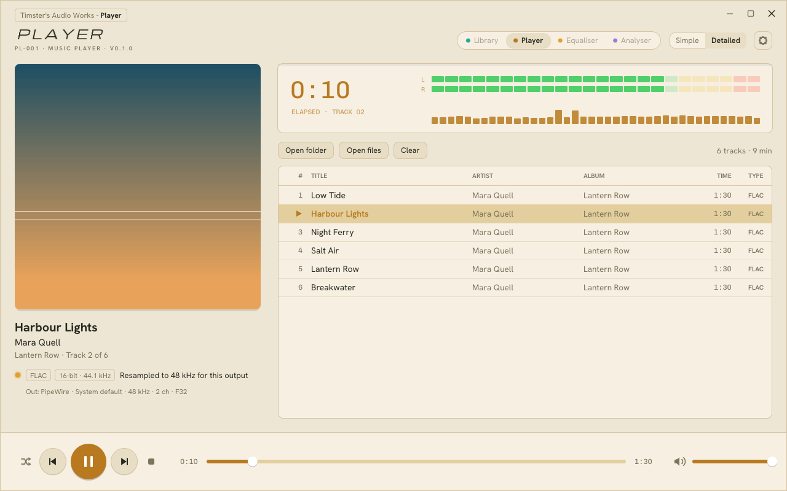

# TAW Player

**Timster's Audio Works – Player (PL-001) v0.1.0**: a native, gapless music player for Windows and Linux, in the TAW look shared with the Library, Equaliser and Analyser (Spool or Porcelain, light or dark). It's the native successor to Spool.



It's a desktop program written in Rust (egui for the panel). It isn't an HTML page in a browser.

**First build.** It plays, and plays properly, but it's young: see [What doesn't work yet](#what-doesnt-work-yet) and [ROADMAP.md](ROADMAP.md).

## What it does

- **Plays folders, files and playlists.** Open a folder (with its sub-folders, in name order, so CD1 comes before CD2), pick files, open an M3U or M3U8 playlist, or drop any of them on the window. FLAC, MP3, WAV, AIFF, ALAC and AAC (M4A) and Ogg Vorbis.
- **Gapless.** The next track is decoded straight on from the last into one continuous stream, so tracks at the same sample rate join with no gap. MP3s with a LAME header have the encoder's delay and padding trimmed, as Spool did. Tested with sine waves cut into tracks at exact sample positions: the joins are seamless and the length is exact.
- **Each track at its own sample rate, where the output allows it**, and it says plainly when it doesn't. Under the track a green light reads *Playing as recorded* (Simple) or *Native rate, untouched* (Detailed); an amber one reads *converted for this output* or *Resampled to 48 kHz for this output* when the output can't take the track's rate. A change of rate between albums reopens the output at the new rate (a short pause between them, not a resample).
- **No false bit-perfect claims.** The Player can only speak for its own part of the path: at 0 dB volume and the native rate it passes the samples on untouched. What the system does after that is the system's business; see [Sample rates and "bit-perfect"](#sample-rates-and-bit-perfect).
- **Tags and artwork**: title, artist and album from the file's tags (or its name), and the cover from a `cover`, `front`, `folder` or `album` JPEG or PNG in the track's folder (or a parent, up to the folder you opened), or the picture in the file.
- **Simple and Detailed.** Simple shows the artwork, the track, the list and the transport, and says what's playing in plain words. Detailed adds the display window (time, LED meters and a spectrum) and the exact format, rate and output.
- **The TAW look**: Spool's warm panels by default (Light, Amber), tinted by any of Spool's seven colour themes, or Porcelain; light, dark or following the computer. The Player draws its own title strip and window buttons; Settings can bring back the system's title bar.
- Volume, output device, look and the rest remembered between runs.

### Keys

| | |
|---|---|
| Space | Play / pause |
| Shift + → / ← | Next / previous track (previous restarts the track if it's past 3 seconds) |
| → / ← | Forward / back 10 seconds |
| ↑ / ↓, Enter | Choose a track, play it |
| Double-click a track | Play it |
| Click the display | Time elapsed or remaining |

**Random** shuffles the list and plays it from the top, like Spool's random play.

## With the rest of the family

The Player needs nothing else. With the others installed:

- **From the Library:** its Play key hands the album to the Player (`taw-player --play album.m3u8`). If the Player is already open it takes the album and the second launch closes; if the Player can't be found, the Library uses the default music player as before.
- **The family switcher** along the top starts the Library, the Equaliser and the Analyser. An app that wasn't found is dimmed. The Player looks next to the Player, in a folder beside the Player's (two unzipped downloads side by side), in `Program Files\Timster's Audio Works\<App>` or `%LOCALAPPDATA%\Programs\Timster's Audio Works\<App>` on Windows, or on the PATH. If it isn't found, the Player says so; click it again to show the Player where the app is, and it remembers.

From a terminal or another program:

```sh
taw-player [--play] [FILE | FOLDER | PLAYLIST.m3u8 ...]
```

## Sample rates and "bit-perfect"

The Player decodes every file at its own rate and never resamples unless it has to. Whether it has to depends on the output:

- **Linux (PipeWire):** the Player asks for the track's own rate. PipeWire then plays it at that rate only if it's in PipeWire's allowed rates (`default.clock.allowed-rates`); otherwise PipeWire itself resamples to its graph rate, which the Player is told and shows. To let PipeWire follow your music, set for example `default.clock.allowed-rates = [ 44100 48000 88200 96000 176400 192000 ]` in a `~/.config/pipewire/pipewire.conf.d/` file.
- **Windows:** the Player uses WASAPI shared mode, where Windows mixes everything at one rate (the one set in Sound settings for the device). A track at another rate is resampled by the Player, and the panel says so. Exclusive mode, which would bypass the mixer, is on the roadmap.
- **Volume** at anything but 0 dB changes the samples; the panel says so.

## What doesn't work yet

- No exclusive mode (WASAPI) yet, and no ASIO.
- AAC (M4A) tracks aren't trimmed of the encoder's delay, so an AAC album has a tiny gap at each join. FLAC, WAV, AIFF, ALAC and LAME-tagged MP3 are seamless.
- No hardware media keys or system media controls yet.
- No CUE sheets, no playlist editing (reorder, remove), no saving playlists, no "add to the list"; opening replaces the list.
- Multichannel files are played as their first two channels on a stereo output (no downmix).
- No VU meters or Retro look (Spool's) yet.

See [ROADMAP.md](ROADMAP.md) for the full list against Spool.

## Where things are kept

- Settings: eframe's usual place for an app called "TAW Player".
- `%APPDATA%\Timster's Audio Works\Player` on Windows, `~/.local/share/timsters-audio-works/player` on Linux: the files that let a second launch hand its files to the running Player. Nothing else is written, and the Player never changes your music.

## Building

```sh
cargo build --release
```

On Linux you need the usual desktop libraries (X11 or Wayland, libxkbcommon) and the PipeWire and ALSA headers (`libpipewire-0.3-dev libspa-0.2-dev libasound2-dev libclang-dev`). The Windows build needs nothing extra.

### Test tracks

`tools/make-test-tracks.sh` (needs ffmpeg) builds test tracks in `tools/fixtures/`: continuous sine waves cut into FLAC, WAV and MP3 tracks at exact sample positions (any gap or click at a join is easy to hear and to measure), one track in each format, a rate change, and a tagged album with a cover.

```sh
tools/make-test-tracks.sh
cargo test -- --include-ignored     # also decodes every test track
cargo run --release -- tools/fixtures/gapless-flac
```
